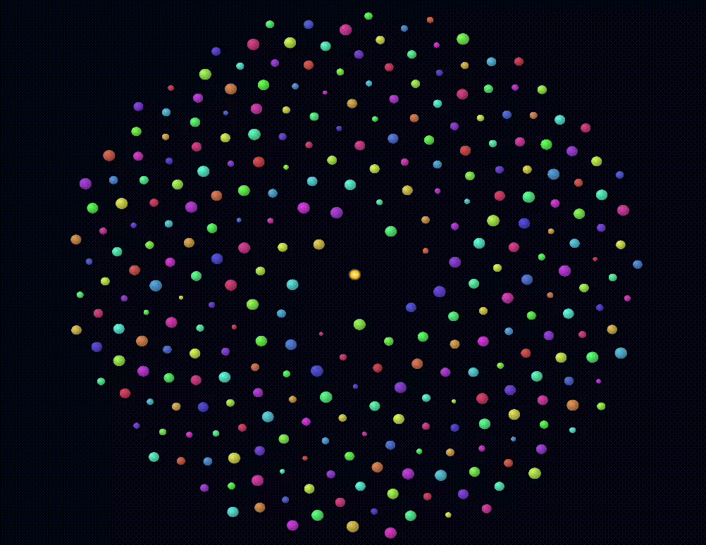
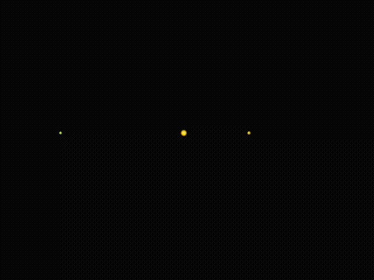

# N-Bodies

A 2D gravitational N-body simulation written in Rust with the
[krABMaga](https://github.com/krABMaga/krABMaga) agent-based modeling framework
(Bevy-based visualization). The interface and the initial configurations are
inspired by the NetLogo
[N-Bodies](https://www.netlogoweb.org/launch#http://ccl.northwestern.edu/netlogo/models/models/Sample%20Models/Chemistry%20&%20Physics/Mechanics/Unverified/N-Bodies.nlogox)
model.





## Features

- Every body is a krABMaga **agent** attracted by all the others (Newtonian gravity, O(N²)).
- **Trails**: the path of the first *N* bodies is drawn as fading polylines
  (Bevy gizmos, no extra sprites), colored like the body they belong to.
- **Control window** (egui) to change the parameters live or regenerate the system.
- Four **initial configurations**: star with circular orbits, stable two-planet
  system, random with zero momentum, symmetrical (zero-sum).
- Optional **keep centered** mode that pins the center of mass to the middle of the view.
- Negative `G` turns gravity into a repulsive force.

## Requirements

- Rust (stable) with `cargo`
- The system libraries Bevy needs on your platform
  (see the [Bevy setup guide](https://bevy.org/learn/quick-start/getting-started/setup/))

## Run

```bash
# Visualization (window with the simulation and the menus)
cargo run --release --features visualization

# Headless (no window, runs 1000 steps)
cargo run --release
```
Press **▶ Start** in the left panel to begin.

`Cargo.toml` needs the egui dependency used by the menu:

```toml
[dependencies]
krabmaga  = "0.6"
bevy_egui = { version = "0.39", optional = true }

[features]
visualization      = ["krabmaga/visualization", "bevy_egui"]
visualization_wasm = ["krabmaga/visualization_wasm", "bevy_egui"]
```

Use the same `bevy_egui` version as krABMaga (check with
`cargo tree --features visualization -i bevy_egui`: only one version must appear).

## How it works

**Physics.** For each body *i* the acceleration is

```
a_i = Σ_j  G · m_j · (r_j − r_i) / (|r_j − r_i|² + ε²)^(3/2)
```

where `ε` is the *softening* length, which avoids huge forces in close
encounters. Integration uses the semi-implicit (symplectic) Euler method:
`v ← v + a·dt`, then `x ← x + v·dt` with the new `v`.

**Synchronous update.** All the physical data live in `NBodyState`
(single source of truth). During a step each `Body` agent reads the snapshot
`state.bodies` and writes its new data in `state.next`; in `after_step` the
state copies `next` into `bodies`. Every body therefore sees the same instant,
independently of the agents' execution order. The same hook recenters the
system (if enabled) and records the trail points.

**Rendering.** Sprites read their position and size from the state every
frame. The planets are tinted with a per-body color (`body_color`), and the
trail of a body uses the same color with a fading alpha.

## Menu

The default krABMaga panel (left) provides Start / Pause / Stop and the steps
per second. **Stop** regenerates the system using the current parameters.
The floating **N-Bodies** window adds:

| Parameter | Effect | Applied |
|---|---|---|
| Configuration | Initial layout (see below) | Setup |
| Number of bodies | Total number of bodies (2–300) | Setup |
| Central mass | Mass of the star (or mass scale in random setups) | Setup |
| Max planet mass | Upper bound of planet masses | Setup |
| Initial speed | Maximum initial speed in random setups | Setup |
| Bodies with trail | How many bodies get a trail | Setup |
| G | Gravitational constant (negative = repulsive) | Live |
| dt | Integration time step | Live |
| Softening | Smoothing length ε of the force | Live |
| Keep centered | Keep the center of mass in the middle of the view | Live |
| Show trails / Trail length | Toggle and length of the trails | Live |

The window also shows how many bodies are currently **outside the view**.
After pressing **Setup** the simulation is paused: press ▶ Start again.

### Configurations

| Name | Description |
|---|---|
| Star + circular orbits | Heavy star at the center, planets on a spiral (golden angle) with circular-orbit speed |
| Two planets (stable) | Star and two planets on opposite sides, at different radii |
| Random (zero momentum) | Random positions, velocities and masses; net momentum removed so the system doesn't drift |
| Symmetrical (zero-sum) | Half of the bodies are random, the other half are their mirror image (opposite position and velocity) |

## Tips

- Bodies that "escape" are usually the effect of close encounters: increase
  *Softening*, decrease *dt*, or lower *Max planet mass*.
- If nothing seems to move, check that the simulation is started and try a
  larger `G` or `dt`.
- The simulation area is `980 × 720`: Bevy's default window is 1280 × 720 and
  krABMaga reserves 300 px on the left for its panel, so this keeps the scale
  1:1. If you resize the window the scene is stretched accordingly.
- Sprites: `Emoji("sun")` and `Emoji("planet")` are loaded from
  `assets/emojis/sun.png` and `assets/emojis/planet.png`. If you change the
  image size, update `SPRITE_PX` in `visualization/body_vis.rs`.
- The default values (`G = 100`, `dt = 0.05`, softening `5`) are defined in
  `Params::default()` in `model/state.rs`.

## References
- http://ccl.northwestern.edu/netlogo/models/N-Bodies
